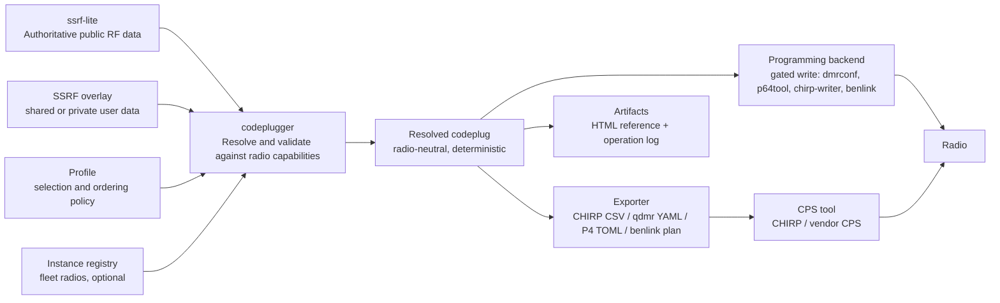

# codeplugger

**🌐 [Project site](https://codeplugger.chicagooffline.com/)**

`codeplugger` builds radio codeplugs from shared RF data and user-owned
configuration. It aims to be a general-purpose codeplug compiler: SSRF data
plus a profile compiles deterministically into a validated, radio-neutral
codeplug, and vendor CPS tools are replaceable export or programming
backends rather than the workflow. It targets analog radios CHIRP supports,
DMR radios qdmr supports (Baofeng DM-32, DM-1701, OpenGD77), the Retevis
MateTalk P4, and Benshi Bluetooth radios; `codeplugger radios` lists the
current set, and the [project site](https://codeplugger.chicagooffline.com/)
shows which of them have been programmed on hardware.

Intent, guiding principles, current state, and the roadmap live in
[docs/plan.md](docs/plan.md). The site source is in `site/`.

## Quick start

The install pulls in `ssrf-lite` with its published RF data, so nothing else
needs cloning. With a radio in a box and an intention, `codeplugger` is the
whole workflow:

```bash
git clone https://github.com/Chicago-Offline/codeplugger.git
cd codeplugger
uv sync

# What is supported, and what can go on it?
uv run codeplugger radios
uv run codeplugger use-cases

# Compile a GMRS handheld for a 16-channel Baofeng, touching no hardware
uv run codeplugger build --radio baofeng_bf888s --use-case gmrs

# Then program it, through the backend's confirm / backup / read-back gates
uv run codeplugger program --radio baofeng_bf888s --use-case gmrs \
  --port /dev/cu.usbserial-10 --confirm
```

A use case carries more channels than most radios hold, so `build` fits it to
the radio: channels it physically cannot use are dropped, then whole zones in
the order the use case ranks them. Every drop is printed and has to be accepted
(`--accept-fit` in a script) before anything is written, and `--zones` takes the
decision back if the automatic fit is not the one you wanted.

A community group's channels work the same way. `codeplugger profiles` lists
the registered collections, and `--profile` takes one by name, with `--radio`
picking the profile for the radio in your hand:

```bash
uv run codeplugger profiles
uv run codeplugger program --radio baofeng_bf888s --profile chioff \
  --port /dev/cu.usbserial-10 --confirm
```

Those collections are the same ones the site builds its downloads from, so
anything you can download you can also program directly. A collection that
lives in another repository has to be cloned next to this one; the error says
which `git clone` to run.

`--profile` also takes a git URL or a local directory, so a group does not have
to be in the registry to be usable:

```bash
uv run codeplugger build --radio baofeng_bf888s \
  --profile https://github.com/example/our-profiles        # or ...#v2 to pin
uv run codeplugger build --radio baofeng_bf888s --profile ../our-profiles
```

A URL is cloned once into a cache (`--cache-root`, `--refresh` to update) and
the profiles in it are found by content — any YAML with schema version 0.1 and
a `radio` — so a repository does not have to adopt this project's layout. Only
git's ordinary transports are accepted; `ext::` runs arbitrary commands and is
refused. If the repository ships SSRF data of its own under `ssrf/`, it is used
as an overlay.

To get a collection into the registry so others can reach it by name, add an
entry to [site/codeplug-sources.json](site/codeplug-sources.json) and open a
pull request. Being listed is also what gets its codeplugs built and published
as downloads on every change.

For profiles you already own, the two original commands are unchanged:

```bash
# Validate an example and print it as CHIRP CSV
uv run codeplugger-profile examples/profiles/baofeng_uv5r_mini/example.yml \
  --instance-registry examples/instances.yml \
  --output-format chirp-csv

# Dry-run every radio in the example registry
uv run codeplugger-fleet \
  --instance-registry examples/instances.yml \
  --profiles-root examples/profiles
```

When it is time to describe your own radios, copy `examples/` out into its own
repository and edit from there; [examples/README.md](examples/README.md) walks
through that. Profiles for real radios do not belong in this repository.
`codeplugger build --profile` and `codeplugger program --profile` take a path
to one of those profiles as readily as a collection name.

## Workflow



The diagram source is also available in [docs/workflow.mmd](docs/workflow.mmd).

## Documentation

- [docs/profiles.md](docs/profiles.md): the profile format, inheritance,
  SSRF roots and overlays, exporter extensions (CHIRP scan skip, qdmr
  settings and DMR APRS), and the instance registry.
- [docs/backends.md](docs/backends.md): each exporter and programming
  backend, with the write gates it enforces: CHIRP CSV and `chirp-writer`,
  qdmr YAML and `dmrconf`, P4 TOML and `p64tool`, benlink.
- [docs/operations.md](docs/operations.md): HTML reference artifacts,
  operation logs, and the registry-driven fleet dry run.
- [docs/architecture.md](docs/architecture.md): which repository owns which
  input, merge precedence, and the public reference repositories.
- [docs/plan.md](docs/plan.md): intent, current state with the evidence
  behind each radio's status, and the sequenced roadmap.
- [examples/README.md](examples/README.md): starting your own profile
  repository from the examples.

## Status

Profile resolution and validation, use-case fitting, the fleet dry run, the
four exporters and their gated write backends, and HTML/operation-log
artifacts are working today. Which radios have had a codeplugger-generated
codeplug written to them and read back is recorded per radio on the
[project site](https://codeplugger.chicagooffline.com/); the benlink path has
not yet been accepted against a physical radio. Prebuilt community codeplugs
are published at
[codeplugger.chicagooffline.com/codeplugs/](https://codeplugger.chicagooffline.com/codeplugs/)
so members can download a file without installing anything. What comes next,
and what is deliberately deferred, is in [docs/plan.md](docs/plan.md).
